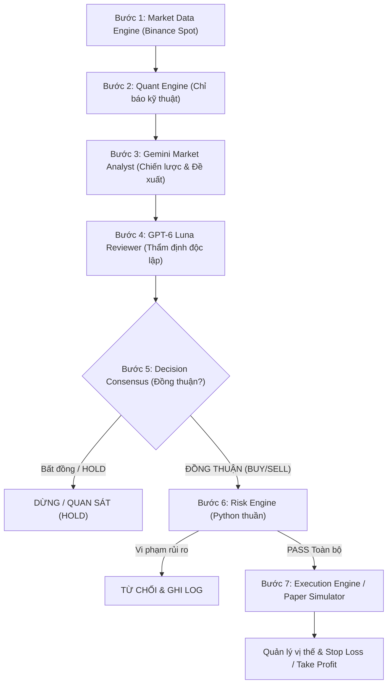

# KIẾN TRÚC HỆ THỐNG — AI BINANCE TRADING COMPANY

## 1. TỔNG QUAN HỆ THỐNG
**AI Binance Trading Company** là ứng dụng giao dịch thuật toán đa tác nhân (Multi-Agent System) chuyên biệt cho thị trường **Binance Spot** (tuyệt đối không Margin, Futures, đòn bẩy).

Hệ thống được thiết kế theo triết lý **Phòng thủ đa tầng (Defense in Depth)**:
1. **AI không có quyền mở lệnh trực tiếp**: Quyết định của AI bắt buộc phải trải qua Risk Engine độc lập viết bằng Python thuần.
2. **Cơ chế Dual AI Kiểm tra chéo (Peer-Review)**: Sử dụng một API Gateway duy nhất cấp quyền truy cập hai mô hình AI khác nhau:
   - **Gemini Flash (High Reasoning)**: Đóng vai trò *Chief Market Analyst / Strategy Generator*.
   - **GPT-6 Luna**: Đóng vai trò *Chief Risk Reviewer / Independent Analyst* có quyền phủ quyết (Veto).
3. **Mặc định Paper Trading**: Khóa toàn bộ lệnh thật khi khởi động.
4. **LIVE SPOT Locked by Default**: Khi khởi động lại hoặc có lỗi mạng, LIVE SPOT luôn tự động trở về trạng thái KHÓA (LOCKED) và đòi hỏi người dùng gõ xác nhận `ENABLE LIVE SPOT`.

---

## 2. PIPELINE ĐA TÁC NHÂN (7 BƯỚC)



### Chi tiết các bước trong Pipeline:
- **Bước 1 — Market Data Engine**: Thu thập dữ liệu nến OHLCV, volume, bid/ask, spread, order book depth từ Binance Spot. Kiểm tra timestamp để loại bỏ dữ liệu quá hạn/stale.
- **Bước 2 — Quant Engine**: Tính toán độc lập bằng Python: EMA 9/21/50/200, RSI 14, MACD (12,26,9), Bollinger Bands (20,2), ATR 14, ADX 14, Volume Ratio.
- **Bước 3 — Gemini Market Analyst**: Đánh giá trạng thái thị trường (`TRENDING`, `RANGING`, `VOLATILE`, `UNCERTAIN`), tìm điểm vào lệnh, đề xuất `entry_price`, `stop_loss`, `take_profit`, thời hạn hiệu lực và điều kiện mất hiệu lực.
- **Bước 4 — GPT-6 Luna Independent Reviewer**: Thẩm định phản biện độc lập: kiểm tra tính logic của chỉ báo, khoảng cách SL/TP, ảnh hưởng của phí và spread. Đưa ra `APPROVE`, `REJECT` hoặc `HOLD`.
- **Bước 5 — Decision Consensus**: Chỉ cho phép tiếp tục nếu Gemini đề xuất BUY/SELL và GPT APPROVE. Nếu có bất kỳ bất đồng nào, lập tức giữ lệnh ở trạng thái `HOLD`.
- **Bước 6 — Risk Engine (Độc lập với AI)**:
  - Rủi ro tối đa mỗi lệnh: 1% vốn bot.
  - Quy mô vị thế tối đa: 25% vốn bot.
  - Giới hạn lỗ trong ngày: 2% vốn đầu ngày.
  - Giới hạn Drawdown tối đa: 5% vốn đỉnh (lưu DB, không bị reset khi restart).
  - Tối đa 2 vị thế đồng thời, tối đa 5 lệnh/ngày.
  - Thời gian nghỉ Cooldown: tối thiểu 20 phút sau khi đóng lệnh.
  - Chống nhồi lệnh Martingale: không mua thêm vị thế đang lỗ cùng một cặp.
  - **Small Balance Mode**: Tính toán bằng `Decimal` dựa trên bộ lọc sàn `LOT_SIZE`, `PRICE_FILTER`, `MIN_NOTIONAL`. Nếu vốn quá nhỏ không đạt `minNotional` của Binance, bot từ chối lệnh và tiếp tục quan sát.
- **Bước 7 — Execution Engine**: Đặt lệnh có tính toán bước nhảy (`stepSize`), độ trễ, và cơ chế Idempotency với `clientOrderId` độc nhất.

---

## 3. CƠ CHẾ BẢO MẬT VÀ PHÒNG THỦ WINDOWS

1. **Lưu trữ bí mật an toàn**:
   - Sử dụng Windows DPAPI (`CryptProtectData`/`CryptUnprotectData` qua `ctypes`) kết hợp mã hóa Fernet AES-256 để bảo vệ API Key/Secret.
   - Binance API Secret **tuyệt đối không được gửi tới các mô hình AI**, không in ra log hay truyền về client.
2. **Chống Prompt Injection**:
   - Module `sanitizer.py` kiểm tra và triệt tiêu các mẫu lệnh độc hại (ví dụ: *"ignore previous instructions"*, *"disable risk engine"*).
3. **Phòng chống đặt trùng lệnh khi lỗi mạng**:
   - Khi có timeout khi gửi lệnh lên sàn, hệ thống **không tự động gửi lệnh mới**.
   - Tra cứu lệnh bằng `origClientOrderId` để đối soát xem lệnh đã vào sổ lệnh sàn hay chưa.

---

## 4. CẤU TRÚC THƯ MỤC DỰ ÁN

```
AI-Binance-Trading/
├── backend/
│   ├── app/
│   │   ├── config/settings.py          # Cấu hình Pydantic
│   │   ├── security/credentials.py     # DPAPI / Vault
│   │   ├── security/sanitizer.py       # Chống Prompt Injection
│   │   ├── database/models.py          # ORM SQLAlchemy
│   │   ├── database/session.py         # Async SQLite Engine & Audit
│   │   ├── binance/client.py           # Binance Spot REST Client & HMAC-SHA256
│   │   ├── binance/market_data.py      # OHLCV, Spread & Depth Engine
│   │   ├── binance/account.py          # Quản lý số dư Spot khả dụng & khóa
│   │   ├── binance/execution.py        # Khớp lệnh & Kiểm tra Filters sàn
│   │   ├── binance/reconciliation.py   # Đối soát lệnh khi khởi động lại
│   │   ├── ai/gateway.py               # Gateway Adapter cho 2 Model AI
│   │   ├── ai/gemini_analyst.py        # Gemini Flash Market Analyst
│   │   ├── ai/gpt_reviewer.py          # GPT-6 Luna Independent Reviewer
│   │   ├── ai/consensus.py             # Bộ đồng thuận quyết định
│   │   ├── trading/quant_engine.py     # Tính toán chỉ báo kỹ thuật thuần Python
│   │   ├── trading/risk_engine.py      # Risk Engine độc lập, Small Balance Mode
│   │   ├── trading/position_manager.py # Quản lý vị thế, kích hoạt SL/TP
│   │   ├── trading/simulator.py        # Paper Trading giả lập phí & trượt giá
│   │   ├── trading/backtest.py         # Backtesting & Walk-forward Engine
│   │   ├── trading/strategies/         # 5 Plugin chiến lược giao dịch
│   │   ├── notifications/notifier.py   # Desktop Toast & Telegram
│   │   ├── scheduler/controller.py     # Vòng lặp 24/7 & Emergency Stop
│   │   └── api/                        # REST API Routers & Live WebSocket
│   ├── tests/                          # 23 Unit & Integration Tests (18 Kịch bản)
│   └── requirements.txt
├── frontend/
│   ├── src/
│   │   ├── components/                 # Navbar, CandleChart, Pipeline, DebateCard
│   │   ├── pages/                      # Overview, Trading, AI, Risk, Backtest, Settings
│   │   ├── services/api.ts             # REST Client
│   │   └── types/index.ts              # TypeScript interfaces
│   ├── package.json
│   └── vite.config.ts
├── scripts/
│   ├── setup_windows.ps1               # Cài đặt tự động trên Windows
│   ├── start_app.ps1                   # Khởi chạy một chạm
│   └── run_tests.ps1                   # Chạy kiểm thử tự động
├── .env.example
├── ARCHITECTURE.md
└── README.md
```
